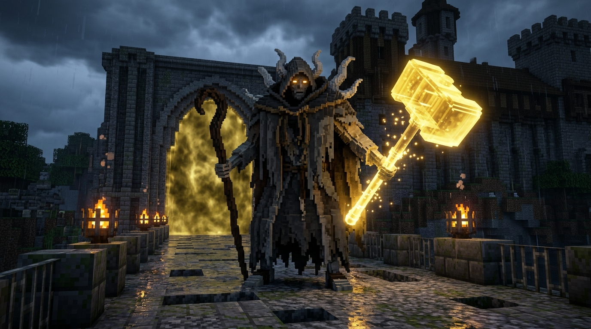
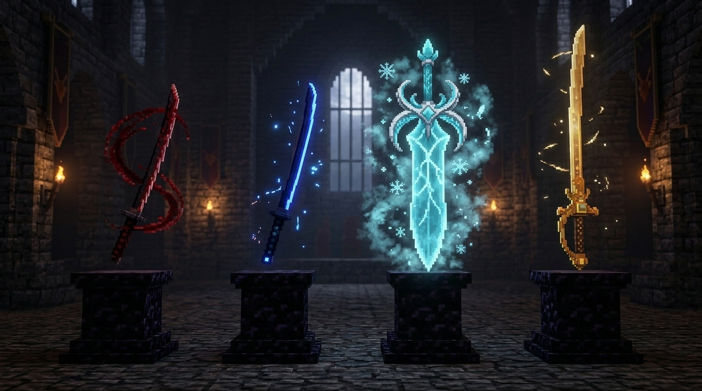
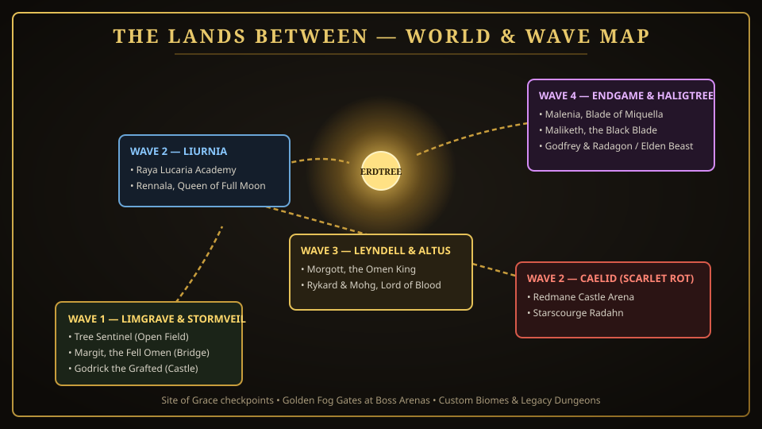

# Elden Ring Core (`eldenring_core`) — Minecraft 1.20.1 Forge

Dự án mod Minecraft **Elden Ring** chơi nội bộ cùng bạn bè (không phát hành công khai), xây dựng theo kiến trúc **Hybrid** trên **Minecraft 1.20.1 + Forge 47.4.4 + GeckoLib 4 + Epic Fight 20.15 + Mixin**.

---

## Mục lục kế hoạch chi tiết từng phần (Click để xem checklist việc cần làm)
1. **[Phần 1: Hệ thống Boss & AI (`part/boss-ai`)](docs/01_BOSS.md)**
2. **[Phần 2: Vũ khí, Ash of War & Combat (`part/weapons-combat`)](docs/02_WEAPONS.md)**
3. **[Phần 3: Bản đồ, Đấu trường & Cơ chế (`part/map-mechanics`)](docs/03_MAP_WORLD.md)**
4. **[Phần 4: 3D Model, Animation & Texture (`part/art-models`)](docs/05_ART_MODELS.md)**
5. **[Phần 5: Âm thanh, UI/HUD & Playtest (`part/audio-ui-qa`)](docs/06_AUDIO_UI_QA.md)**
6. **[Hướng dẫn Chia nhóm & Quy trình Git](docs/04_TEAM_WORKFLOW.md)**

---

## 1. Phần Boss (`boss/`)

- Xây dựng **Boss Framework (`EldenBossEntity`)** dùng chung: State Machine AI, *Delayed Attack*, Phase 2 ở 50% HP, Poise/Stance Break, Hitbox theo frame, Boss Bar & banner **GREAT ENEMY FELLED / DEMIGOD FELLED**.
- Boss mẫu đã có khung code: **`Margit, the Fell Omen`**.
- Mở rộng theo 4 Wave: *Tree Sentinel, Godrick → Rennala, Radahn → Morgott, Rykard, Mohg → Malenia, Maliketh, Godfrey, Radagon*.
- 👉 Chi tiết: [docs/01_BOSS.md](docs/01_BOSS.md)

---

## 2. Phần Vũ khí & Combat (`combat/`)

- Kết hợp **Epic Fight** (Roll i-frames, Stamina, Parry, Lock-on) + **Ash of War** chuột phải + **Status Build-up** (*Bleed, Frostbite, Scarlet Rot*).
- Đã có sẵn khung 4 vũ khí biểu tượng: *Rivers of Blood*, *Moonveil*, *Dark Moon Greatsword*, *Hand of Malenia*.
- Port vũ khí từ *Elden Ring Weapons Pack* (1.19.2 → 1.20.1) và tích hợp giáp *Nightreign Gear* (1.20.1).
- 👉 Chi tiết: [docs/02_WEAPONS.md](docs/02_WEAPONS.md)

---

## 3. Phần Bản đồ & Cơ chế Thế giới (`mechanic/` & `data/`)

- Chia vùng đất theo 4 Wave tương ứng game gốc (*Limgrave/Stormveil → Liurnia/Caelid → Leyndell/Altus → Endgame/Haligtree*).
- Đã có sẵn khung **Site of Grace** (hồi máu + hồi Flask + đặt respawn + banner *LOST GRACE DISCOVERED*), **Flask of Crimson Tears**, và **Golden Fog Gate**.
- 👉 Chi tiết: [docs/03_MAP_WORLD.md](docs/03_MAP_WORLD.md)

---

## 4. Yêu cầu môi trường & Chia nhóm
- **Java**: JDK 17 (khuyên dùng Eclipse Temurin 17).
- **Model 3D**: [Blockbench](https://www.blockbench.net/) + plugin **GeckoLib Animation Utils**.
- **Nhóm làm chung**: Xem phân công 5 vai trò & quy trình Git tránh xung đột tại [docs/04_TEAM_WORKFLOW.md](docs/04_TEAM_WORKFLOW.md).
