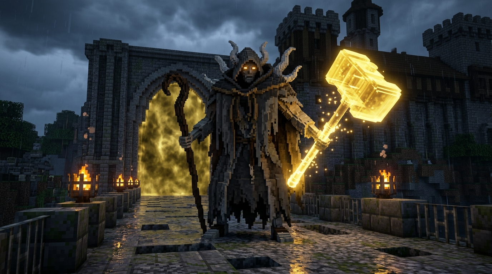

# Kế Hoạch Chi Tiết — Phần 1: Boss & AI (`part/boss-ai`)

- **Nhánh Git**: `part/boss-ai`
- **Thư mục code**: `src/main/java/com/eldenringcore/boss/`
- **File đăng ký chung**: `ModEntities.java`, `ModItems.java` (Spawn Egg), `EldenRingCore.java` (Attributes)

---

## Checklist Công Việc Theo Từng Wave

### Wave 1 — Limgrave & Stormveil *(Ưu tiên cao nhất)*
- [x] **Khung dùng chung `EldenBossEntity`**: State Machine, Delayed Attack, Phase 2, Poise Break, Arc/AoE Hitbox, Boss Bar & Banner.
- [x] **Margit, the Fell Omen (`MargitEntity`)**: Đủ 6 chiêu (*Delayed Cane Slam, Golden Dagger Combo, Tail Sweep, Glintblade Throw, Phase 2 Hammer Leap, Holy Sword 3-Hit Combo*) + Loot rơi.
- [x] **Tree Sentinel (`TreeSentinelEntity`)**: Đủ 5 chiêu (*Halberd Charge, Wide Sweep, Delayed Smash, Phase 2 Golden Shield Slam, Erdtree Retaliation*) + Loot rơi.
- [x] **Godrick the Grafted (`GodrickEntity`)**: Đủ 4 chiêu (*Delayed Axe Cleave, Storm Whirlwind, 2-Hit Earthquake Slam, Phase 2 Dragon Fire Breath* + câu thoại *"BEAR WITNESS!"*) + Loot rơi.
- [x] **Gắn GeckoLib Client Renderer (`EldenBossRenderer` + `ClientModEvents`)**: Sẵn sàng nạp model từ nhánh `part/art-models` cho cả 3 Boss Wave 1.

### Wave 2 — Liurnia & Caelid
- [x] **Rennala, Queen of the Full Moon (`RennalaEntity`)**: Glintstone Barrage, Lunar Barrier, Phase 2 Comet Azur, Full Moon Orb & Spirit Summon Wolves.
- [x] **Starscourge Radahn (`RadahnEntity`)**: Gravity Greatbow, Colossal Dual Cleave, Starcaller Cry (hút trọng lực + nổ), Phase 2 Meteor Crash lao thiên thạch.

### Wave 3 — Leyndell, Volcano & Mohgwyn
- [x] **Morgott, the Omen King (`MorgottEntity`)**: Holy Spear Charge, Sword Rain, Phase 2 Cursed-Blood Slice tích tụ Bleed.
- [x] **Rykard, Lord of Blasphemy (`RykardEntity`)**: Magma Sweep, Ground Eruption, Phase 2 Rancor Skull Storm + câu thoại *"TOGETHAAA!"*.
- [x] **Mohg, Lord of Blood (`MohgEntity`)**: Trident Sweep, Bloodboon Rain, Phase 2 **"NIHIL!"** hồi máu & kích nổ Bleed toàn sân.
- [x] **Fire Giant (`FireGiantEntity`)**: 1600 HP, Plate Snow Sweep, Colossal Roll, Phase 2 Fell God Flame Pillars.

### Wave 4 — Endgame (Đỉnh cao)
- [x] **Malenia, Blade of Miquella (`MaleniaEntity`)**: Hút máu mỗi đòn đánh, *Waterfowl Dance* 3 đợt chém lốc, Phase 2 *Goddess of Rot* + *Scarlet Aeonia* (Scarlet Rot) + rơi *Hand of Malenia*.
- [x] **Maliketh, the Black Blade (`MalikethEntity`)**: Beast Claw, Acrobatic Slash, Phase 2 *Destined Death* gây Wither nặng.
- [x] **Godfrey / Hoarah Loux (`GodfreyEntity`)**: Great-Axe Cleave, Arena Stomp, Phase 2 *Hoarah Loux, Warrior* + *Earthshaker*.
- [x] **Radagon of the Golden Order (`RadagonEntity`)**: Golden Teleport Smash, Lightning Spear, Phase 2 *Triple Golden Order Slam* + banner **GOD SLAIN**.

---

## Tiêu Chí Hoàn Thành Mỗi Con Boss (Definition of Done)
1. Có ít nhất **4 chiêu thức** (có chiêu cận chiến, chiêu tầm xa/áp sát, chiêu *delayed attack*).
2. Có **Phase 2** rõ ràng (đổi nhạc, hiệu ứng chuyển phase, mở khóa chiêu mới).
3. Test trong game bằng `.\gradlew.bat runClient`: né được bằng Roll, phá được Poise, hạ xong hiện banner vàng và rơi đúng đồ.
