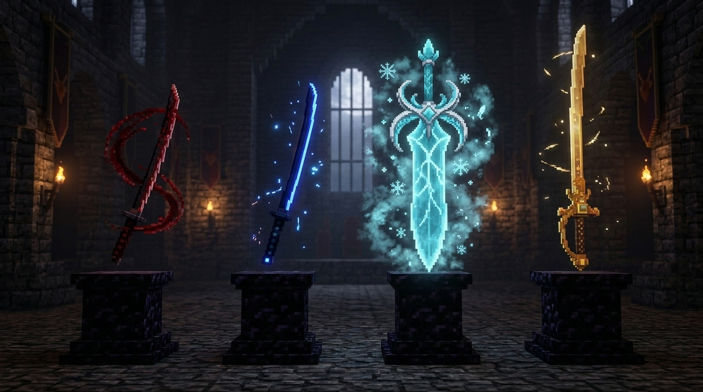

# Kế Hoạch Chi Tiết — Phần 2: Vũ Khí, Ash of War & Combat (`part/weapons-combat`)

- **Nhánh Git**: `part/weapons-combat`
- **Thư mục code**: `src/main/java/com/eldenringcore/combat/`
- **Thư mục tài nguyên**: `src/main/resources/assets/eldenring_core/models/item/`, `src/main/resources/data/epicfight/capabilities/weapons/`

---

## Checklist Công Việc Theo Từng Giai Đoạn

### Giai đoạn 1 — Hoàn thiện 4 Vũ khí Khởi đầu & Hệ thống Status *(Ưu tiên)*
- [x] Tạo khung `EldenWeaponItem` & `StatusBuildupManager` (Bleed, Frostbite, Scarlet Rot).
- [x] Khởi tạo 4 vũ khí: *Rivers of Blood*, *Moonveil*, *Dark Moon Greatsword*, *Hand of Malenia*.
- [ ] **Nâng cấp Ash of War**:
  - [ ] Thêm hệ thống **FP / Mana** tiêu thụ khi dùng Ash of War (hoặc đồng bộ trực tiếp với Mana của *Iron's Spells 'n Spellbooks*).
  - [ ] Nâng cấp *Corpse Piler* thành combo 2–3 nhịp chém máu nối tiếp.
  - [ ] Nâng cấp *Transient Moonlight* cho phép giữ Shift + Chuột phải (chém dọc tầm xa) vs Chuột phải thường (chém ngang rộng).
- [ ] **Tích hợp Epic Fight**:
  - [ ] Tạo file JSON trong `data/epicfight/capabilities/weapons/` cho từng vũ khí (gán `katana`, `greatsword`, `longsword`, `spear`, `tachi`) để có bộ combo & animation chuẩn Souls-like.

### Giai đoạn 2 — Port *Elden Ring Weapons Pack* (1.19.2 → 1.20.1)
- [ ] Chép file `.jar` của *Elden Ring Weapons Pack* vào `d:\Mod\reference\` (không commit file `.jar` này lên Git).
- [ ] Trích xuất model/texture các vũ khí đặc sắc nhất (bỏ vũ khí trùng/thừa):
  - [ ] **Blasphemous Blade** (*Taker's Flames*: vệt lửa + hút máu).
  - [ ] **Starscourge Greatsword** (*Starcaller Cry*: kéo quái lại + nổ trọng lực).
  - [ ] **Maliketh's Black Blade** (*Destined Death*: chém chéo rút máu tối đa).
  - [ ] **Bloodhound's Fang** (*Bloodhound's Finesse*: chém xong nhảy lùi né đòn).
  - [ ] **Golden Halberd** (rơi từ Tree Sentinel, buff tăng sát thương & phòng thủ).
  - [ ] **Bolt of Gransax** (phóng sét đỏ tầm xa).
- [ ] Đăng ký toàn bộ vũ khí mới vào `ModItems.java`, `ModCreativeTabs.java`, `en_us.json` và `vi_vn.json`.

### Giai đoạn 3 — Hệ thống Nâng cấp & Cân bằng *Nightreign Gear*
- [ ] Code hệ thống nâng cấp vũ khí bằng **Smithing Stones** (+1 → +25) và **Somber Smithing Stones** (+1 → +10) tại bàn rèn (Anvil / Smithing Table).
- [ ] Kiểm tra & cân bằng chỉ số giáp từ mod **Elden Ring Nightreign Gear (1.20.1)** cho khớp sát thương của Boss Wave 1–4.
- [ ] Thêm tùy chọn **Equip Load** (nhẹ / trung bình / nặng ảnh hưởng tốc độ lăn) nếu nhóm muốn tăng độ khó.

---

## Tiêu Chí Hoàn Thành
1. Mỗi vũ khí đều có **Epic Fight capability** (cầm vào chém có combo mượt, không bị đánh kiểu kiếm vanilla).
2. Chuột phải dùng được **Ash of War** có hiệu ứng particle + âm thanh rõ ràng, không gây lag server.
3. Gắn đầy đủ vào **Loot Table** của Boss hoặc rương trên Map.
