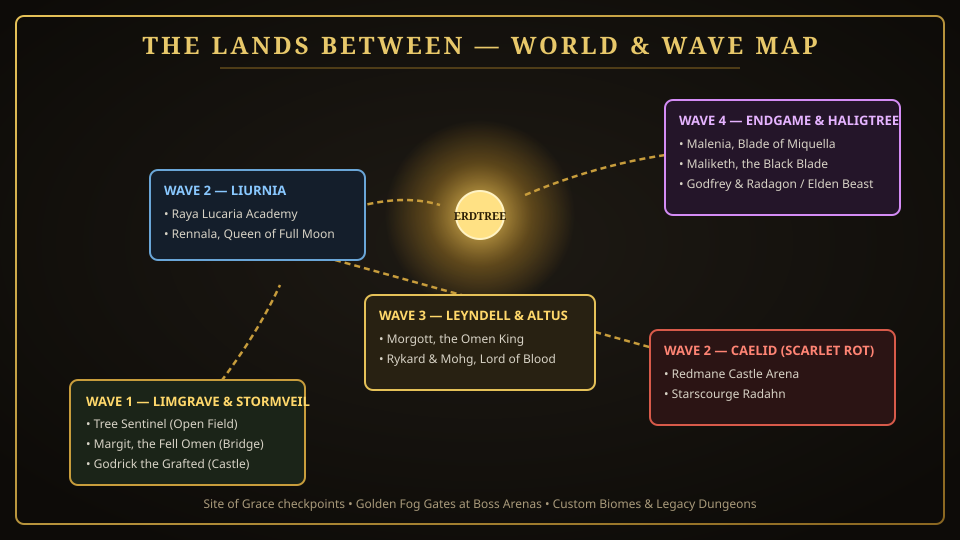

# Phần 3: Bản đồ, Thế giới & Cơ chế Sinh tồn (`mechanic/` & `data/`)

## Cơ chế Thế giới & Sinh tồn cốt lõi
- **Site of Grace (`SiteOfGraceBlock`)**: Điểm nghỉ ngơi — hồi đầy máu, hồi lại toàn bộ bình **Flask of Crimson Tears**, đặt điểm hồi sinh và hiện banner **LOST GRACE DISCOVERED**.
- **Golden Fog Gate (`FogGateBlock`)**: Cổng sương vàng ngăn cách đấu trường Boss.
- **Flask of Crimson Tears (`CrimsonFlaskItem`)**: Bình máu giới hạn lượt dùng (mặc định 5 bình), chỉ hồi lại khi nghỉ ở Site of Grace.
- **Runes rơi khi chết** *(đang lên kế hoạch Wave 1)*: Rơi toàn bộ Runes tại chỗ chết để quay lại nhặt; chết lần 2 trước khi nhặt thì mất.

## Thiết kế Map / Vùng đất
- **Limgrave & Stormveil** (Wave 1): Đồng cỏ u ám, cầu đá Margit, lâu đài Stormveil.
- **Liurnia & Caelid** (Wave 2): Học viện Raya Lucaria (sương xanh) & vùng đất mục rữa đỏ Caelid.
- **Leyndell & Endgame** (Wave 3–4): Kinh thành hoàng kim dưới gốc Erdtree & Haligtree.
- Kết hợp tinh chỉnh các mod địa hình/dungeon/âm thanh chọn lọc từ *EldenCraft*.
