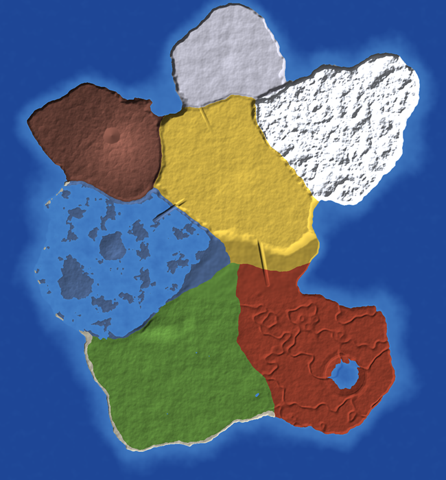

# Modpack Elden Ring Core

Mod `eldenring_core` chạy được một mình (13 Boss, vũ khí, Rune, Grace, Fog Gate, map Wave 1–4).
Thế giới 7 vùng **Lands Between** cần thêm Terralith và các mod công trình/boss, nên nằm ở **modpack**, giống cách DawnCraft làm.

## Cấu trúc

| Đường dẫn | Nội dung |
|---|---|
| `mods.json` | Danh sách 24 mod, **khóa đúng phiên bản** + hash (Epic Fight, GeckoLib, Open Loader, Terralith, Cataclysm, Dungeons Arise, YUNG's...). |
| `overrides/config/openloader/data/eldenring_worldgen/` | Datapack dựng Lands Between: dimension `eldenring_core:lands_between` (biome Terralith) + biome tag / `structure_set` cho 11 mod công trình & boss. Open Loader tự bật cho mọi thế giới. |
| `build-mrpack.ps1` | Đóng gói ra `dist/EldenRingCore-<version>.mrpack`. |

**Quy tắc:** dữ liệu tham chiếu mod khác (`terralith:`, `cataclysm:`...) chỉ để trong `overrides/`, **không** để trong `src/main/resources` — nếu không, người chỉ cài mod sẽ không vào được thế giới.

## Chạy thử khi dev

```powershell
.\gradlew.bat runClient -Pmodpack
```

`-Pmodpack` làm Gradle tự tải đúng 24 mod trong `mods.json` và chép `overrides/` vào `run/`. Không có `-Pmodpack` thì chỉ chạy mod mình (build nhanh).

## Đóng gói & chia sẻ

```powershell
.\gradlew.bat build --no-daemon
powershell -ExecutionPolicy Bypass -File modpack\build-mrpack.ps1
```

Gửi file `.mrpack` cho cả nhóm → mở bằng **Modrinth App** hoặc **Prism Launcher** (Import) → launcher tự tải các mod từ trang gốc.
Chơi chung: cùng một bản `.mrpack`, một người mở LAN (qua Radmin VPN/ZeroTier) hoặc dựng server.

## Thêm / đổi mod

1. Thêm mục vào `mods.json` (lấy `project_id`, `version_id`, `url`, `sha1`, `sha512`, `size` từ trang Modrinth của bản Forge 1.20.1).
2. Nếu cần chỉnh worldgen cho mod đó, thêm file vào datapack trong `overrides/`.
3. Chạy `runServer -Pmodpack` kiểm tra, **và** chạy `runServer` không có cờ để chắc mod một mình vẫn vào được.
4. Tăng `version` trong `mods.json` trước khi phát hành bản mới.

## Địa hình Lands Between (map riêng của nhóm)



- Lục địa do nhóm tự thiết kế, sinh bằng `tools/mapgen/MapGen.java` → `src/main/resources/eldenring_core_worldgen/height.png` (độ cao, 16-bit) + `regions.png` (7 vùng + biển + vách biển). 1 pixel = 4×4 block, phủ X/Z -4096..4095.
- Trong game, `eldenring_core:lands_between` (chunk generator) lấy độ cao từ `height.png`; surface, hang, quặng, cây vẫn theo `minecraft:overworld` + biome Terralith. Biome source đọc `regions.png` nên biome luôn khớp địa hình.
- Sửa map: chỉnh vùng/độ cao trong `MapGen.java` rồi chạy
  `java tools/mapgen/MapGen.java src/main/resources/eldenring_core_worldgen` (JDK 17), xem `preview.png`, build lại. Có thể vẽ tay thẳng lên `height.png` bằng app chỉnh ảnh hỗ trợ 16-bit (giá trị = (Y + 64) × 64).
- Thế giới cũ đã sinh chunk thì không đổi; cần tạo thế giới mới để thấy địa hình mới.
